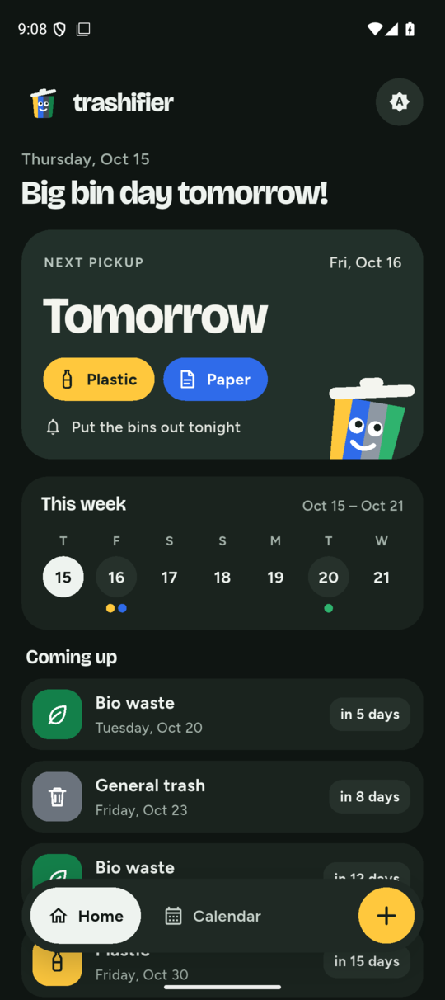
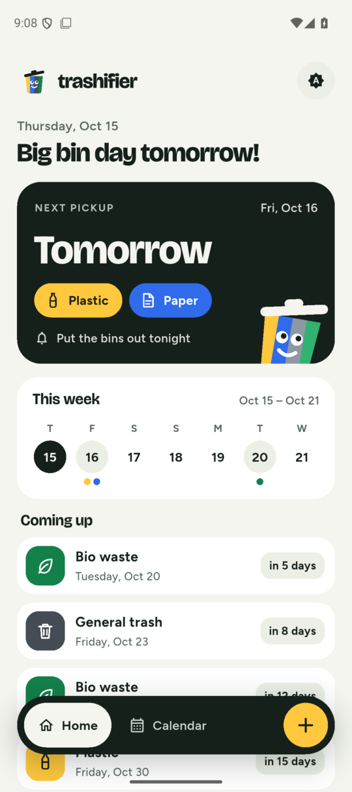

# 🗑️ Trashifier

A Flutter-based mobile application that helps you never miss trash collection day again! Trashifier is your personal waste management assistant that keeps track of different types of trash pickup schedules and sends you timely notifications.

## 🖼️ Screens




## 📱 Features

### 🗑️ Meet Bin Buddy
- **Playful design**: a cheerful bin mascot striped in the four bin colors, chunky rounded cards, Bricolage Grotesque headlines and Figtree body text
- **Two tabs**: Home (next pickup, the next 7 days, what's coming up) and Calendar; swipe between them or use the floating bottom bar, with a yellow + button to add pickups

### 🗓️ Calendar Management
- **Interactive Calendar View**: Month view with a colored bar per bin under each pickup day, and filter chips to show one bin at a time
- **Multiple Trash Types**: Support for different waste categories:
  - 🟡 Plastic waste
  - 🔵 Paper waste
  - ⚫ General trash
  - 🟢 Bio/Organic waste
- **Easy Date Selection**: Tap a day and Edit to toggle its bins in a bottom sheet, or use + to pick every date for one bin at once
- **Visual Indicators**: Color-coded calendar days showing which type of trash gets collected when

### 🔔 Smart Notifications
- **Automated Reminders**: Get notified the day before each collection day (7 PM by default), or on the pickup day itself; pick the day and time in Settings
- **Custom Notifications**: Tailored notification messages for each trash type; several bins on the same day get separate reminders 20 seconds apart
- **Exact Alarm Scheduling**: Uses Android's exact alarm permissions for precise timing
- **Self-healing Schedule**: Reminders are re-armed on every app start, after a reboot and after an app update

### 🎃 Seasonal Themes
- **Halloween (October)**: purple and pumpkin colors, Pumpkin Buddy, ghosts, spiders and pumpkins in random spots (pumpkins only on the widgets), and a pumpkin on Oct 31
- **Christmas (December)**: pine green and red, Santa Buddy, gently falling snow and a string of blinking lights; a tree, an ornament and a gift on Dec 24–26 and champagne on Dec 31
- Both come in light and dark, reach the splash screen and the widgets, and stop animating when the phone's "remove animations" setting is on
- Turn them off in Settings › Seasonal themes
- Debug panel (debug builds only, hold the Settings button for 3 s): force Auto, Normal, Halloween or Christmas, reset the one-time hints

### 📱 Home Screen Widgets
Four styles to pick from in the launcher's widget list:
- **Bold**: the next pickup on its bin colors; several bins on the same day show side by side
- **Clean**: the next pickup on a plain card with round bin tokens
- **Wide**: the next four pickup days with a dot per bin
- **Bin Buddy**: a 1×1 tile with the mascot that opens the app

All widgets follow the system light/dark theme, adapt to narrow sizes and refresh every 6 hours.

### 📋 Home
- **Next Pickup Card**: The next collection day with all of its bins and when the reminder fires
- **Next 7 Days**: Today and the six days after it at a glance; tap a day to edit it
- **Coming Up**: The following pickups with a days-until badge; swipe a row right to remove it (the first row shows this once)

### 🎨 User Experience
- **Settings** (gear button on Home): reminder day and time with a preview of the next reminder, language, Auto/Light/Dark theme, seasonal themes on/off, backup and sharing
- **Languages**: English, German, Spanish and Slovak; follows the phone or a language picked in Settings (also Android 13+'s per-app language setting). Widgets, dates and reminders follow too
- **Backup**: export all pickup dates to a JSON file and import them again, adding to or replacing the current dates
- **Share with your household**: send the upcoming pickups as a file, or show them as a QR code that another phone scans in Settings › Import (Google Play services scanner, no camera permission). Opening a shared file or `trashifier://import` link with Trashifier also offers the import
- **System/Light/Dark Theme**: Follows the system theme by default
- **Responsive Layout**: Optimized for different screen sizes and orientations
- **Persistent Storage**: Your pickup schedules are saved locally and persist between app sessions

### 🔧 Technical Features
- **Android**: Built with Flutter, targeting Android only
- **Local Storage**: Uses SharedPreferences for reliable data persistence
- **Background Processing**: Handles notifications even when the app is closed
- **Permission Management**: Proper handling of notification and alarm permissions
- **Timezone Support**: Pickup dates are stored as calendar days, so they never shift between time zones

## 🚀 Getting Started

### Prerequisites
- Flutter SDK (^3.8.1)
- Android Studio / VS Code
- Android device or emulator (API level 24+)

### Installation

1. **Clone the repository**
   ```bash
   git clone https://github.com/Aboliss/trashifier_app.git
   cd trashifier_app
   ```

2. **Install dependencies**
   ```bash
   flutter pub get
   ```

3. **Run the app**
   ```bash
   flutter run
   ```

## 📖 How to Use

1. **First Launch**: Open the app and grant notification permissions when prompted
2. **Add Pickup Dates**: Tap + and pick a bin to select all of its dates, or open Calendar, tap a day and Edit to choose which bins are collected that day
3. **Set Your Schedule**: Select dates on the calendar for each type of waste collection
4. **Enable Notifications**: Make sure notifications are enabled to receive reminders; change when they arrive in Settings
5. **Stay Organized**: Check the timeline view to see all upcoming pickups at a glance

## 🏗️ Architecture

The app follows a clean architecture pattern with:

- **Models**: Data structures for trash dates and types
- **Services**: Background services for notifications and storage
- **Widgets**: Reusable UI components
- **Helpers**: Utility functions for dates, colors, and formatting
- **Pages**: Main app screens and navigation

## 📦 Dependencies

- `table_calendar` - Interactive calendar widget
- `flutter_local_notifications` - Local notification handling
- `shared_preferences` - Local data storage
- `provider` - State management
- `flutter_svg` - Bin icons and Bin Buddy
- `flutter_localizations` / `intl` - Translations and date formats (strings in `lib/l10n/app_*.arb`)
- `qr` - Draws the share QR code
- Android: `play-services-code-scanner` (QR scanner UI), `androidx.core` (FileProvider for the share sheet)

## 🚢 Releasing

Pushing a tag that matches the `version` in `pubspec.yaml` (e.g. `v1.2.0`) builds a signed APK and AAB and publishes a GitHub release. Every release must be signed with the same key, otherwise Android refuses to install it as an update.

One-time setup:

1. Create an upload keystore (keep it and its passwords somewhere safe; losing it means users must reinstall):
   ```bash
   keytool -genkey -v -keystore upload-keystore.jks -keyalg RSA -keysize 2048 -validity 10000 -alias upload
   ```
2. Add these repository secrets (Settings → Secrets and variables → Actions):
   - `ANDROID_KEYSTORE_BASE64`: output of `base64 -w0 upload-keystore.jks`
   - `ANDROID_KEYSTORE_PASSWORD`, `ANDROID_KEY_ALIAS`, `ANDROID_KEY_PASSWORD`
3. For local signed builds, create `android/key.properties` (git-ignored):
   ```properties
   storeFile=/absolute/path/to/upload-keystore.jks
   storePassword=...
   keyAlias=upload
   keyPassword=...
   ```

Without `key.properties`, release builds fall back to the debug key, which is fine for local testing only.

## 🤝 Contributing

1. Fork the repository
2. Create your feature branch (`git checkout -b feature/AmazingFeature`)
3. Commit your changes (`git commit -m 'Add some AmazingFeature'`)
4. Push to the branch (`git push origin feature/AmazingFeature`)
5. Open a Pull Request

## 📄 License

This project is licensed under the MIT License - see the [LICENSE](LICENSE) file for details.

## 🙋‍♂️ Support

If you encounter any issues or have suggestions for improvement, please open an issue on GitHub.

## 🌟 Acknowledgments

- Built with [Flutter](https://flutter.dev/)
- Fonts: [Bricolage Grotesque](https://github.com/ateliertriay/bricolage) and [Figtree](https://github.com/erikdkennedy/figtree), both under the SIL Open Font License (see `assets/fonts/`)
- App icon and splash are rendered from `assets/icon_sources/*.svg` (`rsvg-convert`, then `dart run flutter_launcher_icons` and `dart run flutter_native_splash:create`)
- Thanks to the Flutter community for the amazing packages used in this project

---

**Never miss trash day again with Trashifier!** 🎯
